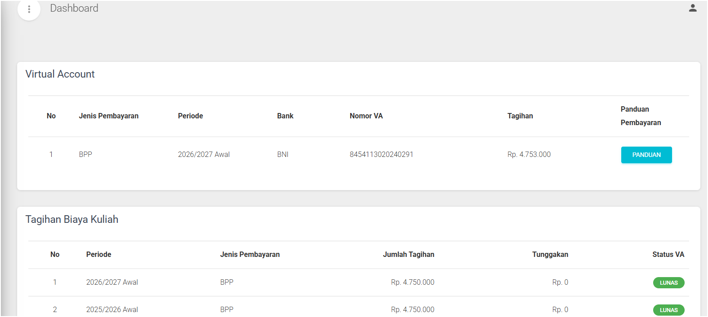
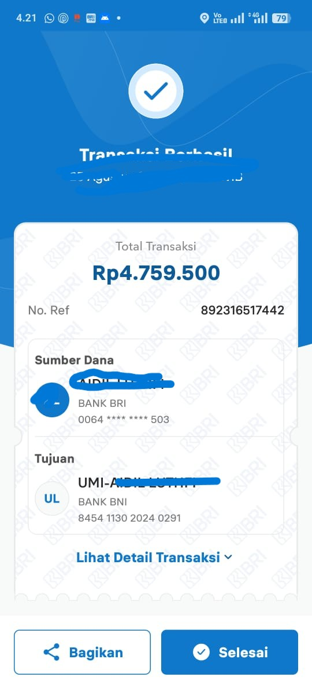

# BAB I PENDAHULUAN (U1)

## 1.1 Deskripsi Layanan dan Komponen Sistem
Bagi mahasiswa Universitas Muslim Indonesia (UMI), membayar biaya kuliah seperti BPP/UKT, biaya laboratorium, hingga wisuda adalah rutinitas wajib setiap semester. Agar proses ini berjalan lancar tanpa harus mengantre di loket kampus, UMI menyediakan **Layanan Pembayaran Biaya Pendidikan** secara daring yang menghubungkan portal akademik kampus dengan sistem perbankan.

Untuk menjaga konsistensi penamaan pada seluruh penjelasan teks dan diagram arsitektur di laporan ini, layanan pembayaran dibagi menjadi empat komponen utama sesuai fungsinya:

* **Modul Informasi Tagihan (`BillingInfoService`):** Komponen yang bertugas menampilkan rincian tagihan mahasiswa per semester, sehingga mahasiswa mengetahui secara pasti nominal yang harus dibayar.
* **Modul Pembayaran (`PaymentGatewayService`):** Komponen yang membangkitkan kode bayar atau nomor *Virtual Account* (VA) bank mitra saat mahasiswa hendak melunasi tagihannya.
* **Modul Konfirmasi Pembayaran (`PaymentCallbackService`):** Komponen penerima pesan otomatis (*webhook/callback*) dari bank. Ketika mahasiswa selesai mentransfer dana, komponen inilah yang menerima laporan dari bank dan langsung mengubah status tagihan menjadi "Lunas".
* **Modul Riwayat Pembayaran (`PaymentHistoryService`):** Komponen yang menyimpan seluruh catatan bukti pembayaran yang sudah berhasil dilunasi. Data pada komponen ini menjadi penentu apakah mahasiswa sudah dapat mengisi Kartu Rencana Studi (KRS) atau belum.

## 1.2 Satu Masalah Utama Layanan
Meskipun pembayaran sudah dapat dilakukan secara daring, terdapat satu masalah utama yang sangat dirasakan oleh mahasiswa di lapangan:

* **Pernyataan Masalah Utama:** Komponen pembayaran kampus saat ini (`PaymentGatewayService`) masih terikat erat (*tightly coupled*) pada metode *Virtual Account* (VA) dari bank mitra tertentu dan belum menyediakan pilihan jalur pembayaran terstandarisasi bebas biaya (seperti QRIS). Akibatnya, mahasiswa harus menanggung biaya admin tambahan, yang bebannya menjadi dua kali lipat apabila mahasiswa membayar menggunakan rekening bank yang berbeda karena adanya tambahan biaya transfer antarbank.
* **Dampak Arsitektur Perangkat Lunak:** Berdasarkan prinsip arsitektur perangkat lunak menurut Bass dkk. [1] serta Richards dan Ford [2], sistem yang dirancang menyatu langsung (*point-to-point*) dengan satu layanan bank akan bersifat kaku dan sulit dikembangkan. Ketika pihak kampus ingin menambahkan metode pembayaran baru yang bebas biaya admin bagi mahasiswa, tim teknis akan kesulitan karena harus mengubah kode program utama pada `PaymentGatewayService` dan `PaymentCallbackService`. Dengan kata lain, sistem saat ini belum fleksibel untuk dimodifikasi (**Modifiability**) dan belum mudah dihubungkan dengan berbagai jalur pembayaran lain (**Interoperability**).

## 1.3 Bukti Masalah Utama
Untuk membuktikan bahwa masalah biaya admin ganda ini benar-benar terjadi, berikut adalah bukti nyata dari pengalaman transaksi mahasiswa (seluruh data pribadi seperti nama, stambuk/NIM, dan nomor rekening telah disensor penuh demi menjaga privasi sesuai aturan akademik):

* **Bukti 1 (Tangkapan Layar Halaman Tagihan Portal UMI):** Bukti tampilan pada `BillingInfoService` dan `PaymentGatewayService` yang menunjukkan bahwa mahasiswa hanya diberikan pilihan pembayaran melalui *Virtual Account* bank mitra, disertai adanya tambahan biaya admin di luar tagihan pokok kuliah.
  > 
* **Bukti 2 (Bukti Struk Transfer Antarbank):** Bukti struk pembayaran dari aplikasi *mobile banking* bank lain milik mahasiswa saat mentransfer ke nomor VA UMI. Pada struk tersebut terlihat mahasiswa terkena potongan ganda, yaitu biaya admin VA (Rp3.000) ditambah biaya transfer beda bank (Rp2.500 melalui BI-FAST atau Rp6.500 melalui transfer *online* reguler), sehingga mahasiswa harus mengeluarkan biaya ekstra hingga Rp5.000–Rp9.500 untuk sekali transaksi.
  > 

## 1.4 Pemangku Kepentingan (*Stakeholders*)
Masalah dan perbaikan pada sistem pembayaran ini berkaitan langsung dengan empat pihak utama:

1. **Mahasiswa (Pengguna Layanan):** Pihak yang paling terdampak dan membutuhkan pilihan pembayaran lintas bank atau *e-wallet* tanpa potongan biaya admin tambahan (Rp0), serta menginginkan status pembayarannya langsung tercatat di `PaymentHistoryService` agar dapat segera mengisi KRS.
2. **Bagian Keuangan UMI (Pengelola Keuangan Kampus):** Pihak yang membutuhkan laporan pemasukan dana kuliah yang tetap rapi, akurat, dan otomatis tercatat di `BillingInfoService`, meskipun mahasiswa membayar dari berbagai kanal bank yang berbeda.
3. **Tim Pengembang / UPT TI UMI (Pengelola Sistem):** Pihak teknis yang membutuhkan desain arsitektur sistem yang fleksibel pada `PaymentGatewayService` dan `PaymentCallbackService`, sehingga mereka dapat menambahkan fitur pembayaran baru (seperti QRIS) dengan cepat tanpa merusak sistem yang sedang berjalan.
4. **Mitra Perbankan / Penyedia *Payment Gateway* (Pihak Eksternal):** Pihak penyedia jalur transaksi yang membutuhkan jalur komunikasi sistem (API/*Webhook*) yang terstandarisasi dan aman untuk mengirim konfirmasi pembayaran otomatis (*real-time*) ke sistem kampus.

## 1.5 Keterkaitan Masalah Utama pada Bab Selanjutnya
Sesuai daftar periksa evaluasi arsitektur, masalah biaya admin akibat kaku dan terbatasnya jalur pembayaran di atas akan diselesaikan secara berkesinambungan pada bab-bab berikutnya:

* **BAB II Skenario (U2):** Menetapkan target perbaikan yang terukur dengan angka jelas (ukuran respons), seperti target biaya admin tambahan bagi mahasiswa menjadi Rp0 dan target waktu penambahan jalur pembayaran baru oleh tim TI cukup dalam hitungan hari kerja.
* **BAB III Taktik dan Pola (U3–U4):** Memilih strategi teknis yang tepat, yaitu menerapkan taktik *Use an Intermediary* [1] dan pola *Adapter Pattern* [2] agar sistem kampus tidak lagi bergantung pada satu bank saja.
* **BAB IV & BAB V Desain, Evaluasi, dan ADR (U5–U7):** Menggambarkan rancangan barunya ke dalam diagram menggunakan empat nama komponen yang konsisten (`BillingInfoService`, `PaymentGatewayService`, `PaymentCallbackService`, `PaymentHistoryService`), menguji kelayakannya dengan metode ATAM [3], serta mendokumentasikan alasan pemilihan solusinya dalam *Architecture Decision Record* (ADR) mengikuti format Nygard [4].

## Referensi (Format IEEE)
[1] L. Bass, P. Clements, and R. Kazman, *Software Architecture in Practice*, 4th ed. Boston, MA, USA: Addison-Wesley, 2021.

[2] M. Richards and N. Ford, *Fundamentals of Software Architecture: An Engineering Approach*. Sebastopol, CA, USA: O'Reilly Media, 2020.

[3] R. Kazman, M. Klein, and P. Clements, "ATAM: Method for Architecture Evaluation," Software Engineering Institute, Carnegie Mellon University, Pittsburgh, PA, USA, Tech. Rep. CMU/SEI-2000-TR-004, 2000.

[4] M. Nygard, "Documenting Architecture Decisions," *Cognitect Blog*, Nov. 15, 2011. [Online]. Available: https://cognitect.com/blog/2011/11/15/documenting-architecture-decisions

[5] Bank Indonesia, *Standar Nasional QR Code Pembayaran (QRIS) dan Kebijakan Skema Harga Layanan BI-FAST*, Jakarta, Indonesia: Bank Indonesia, 2023.
