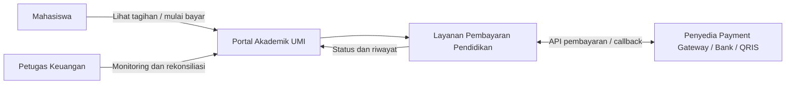
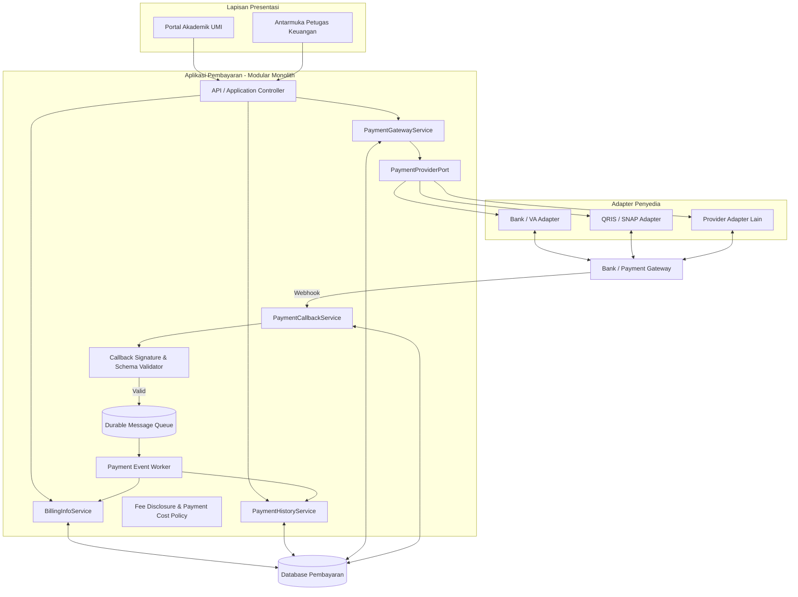
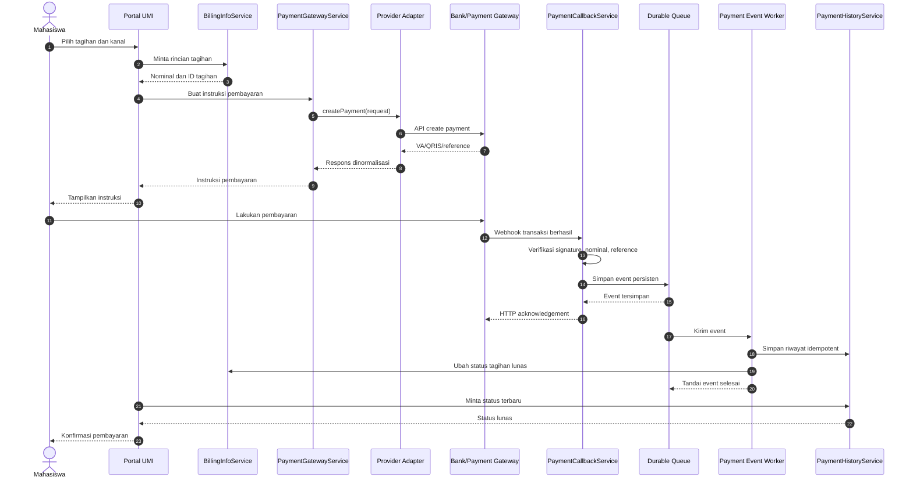
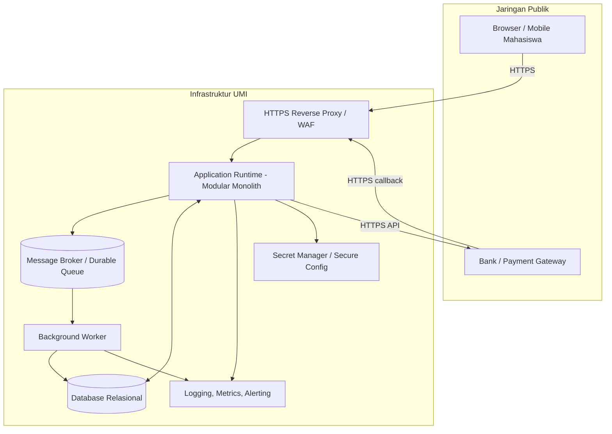

# BAB V -- DESAIN DAN DIAGRAM ARSITEKTUR (U5)

## 5.1 Tujuan dan Prinsip
Desain menerjemahkan taktik U3 dan pola U4. Layanan inti menggunakan kontrak internal; setiap provider diisolasi dalam adapter; sistem mengambil dan menampilkan rincian biaya sebelum mahasiswa mengonfirmasi pembayaran; kebijakan pembayaran mencegah penumpukan biaya VA dan transfer antarbank tanpa informasi yang jelas; callback diverifikasi dan disimpan persisten; pemrosesan idempotent; tagihan dan riwayat diperbarui konsisten; data sensitif tidak dicatat dalam log.

## 5.2 Diagram Konteks

## 5.3 Diagram Komponen

## 5.4 Diagram Urutan Pembayaran

## 5.5 Diagram Deployment Konseptual

## 5.6 Tanggung Jawab Komponen
| Komponen | Tanggung jawab |
|---|---|
| Portal Akademik | Antarmuka mahasiswa dan petugas. |
| `BillingInfoService` | Rincian dan status tagihan. |
| `PaymentGatewayService` | Membuat instruksi pembayaran melalui kontrak provider serta meminta rincian biaya dan menerapkan kebijakan biaya. |
| `PaymentCallbackService` | Menerima, memverifikasi, dan menyimpan callback. |
| `PaymentHistoryService` | Menyimpan dan menampilkan riwayat. |
| `PaymentProviderPort` | Kontrak internal provider. |
| Adapter provider | Menerjemahkan kontrak ke API masing-masing penyedia dan menyampaikan data biaya yang disediakan provider. |
| Fee Disclosure & Payment Cost Policy | Menampilkan total dan komponen biaya sebelum konfirmasi serta menerapkan kebijakan agar biaya VA dan transfer antarbank tidak menumpuk tanpa pemberitahuan. |
| Queue/worker | Memproses event, retry, dan pemulihan. |
| Database | Tagihan, transaksi, riwayat, dan status event. |

## 5.7 Keamanan dan Aturan Data
- Gunakan ID transaksi internal dan ID provider untuk korelasi.
- Terapkan unique constraint pada event/transaksi provider.
- Verifikasi signature sesuai mekanisme provider; jangan hanya mengandalkan IP.
- Validasi nominal, mata uang, merchant, reference, status, dan timestamp.
- Simpan secret di secret manager, bukan repository.
- Gunakan HTTPS/TLS, least privilege, audit log, dan minimisasi data sensitif.
- Sediakan rekonsiliasi dengan laporan provider.

## 5.8 Asumsi dan Batasan
Diagram bersifat konseptual, bukan bukti implementasi. Provider, broker, database, dan infrastruktur final belum ditentukan. SNAP/QRIS harus mengikuti spesifikasi dan kontrak yang berlaku. Target biaya tambahan Rp0 bergantung tarif provider dan kesepakatan kampus. Jika tidak tercapai, komponen biaya harus ditampilkan secara jelas sebelum transaksi dan kebijakan harus menghindari penumpukan dua biaya tanpa pemberitahuan. Target lima detik harus diuji end-to-end.

## 5.9 Kesimpulan
Desain memisahkan layanan inti dari variasi provider melalui kontrak dan adapter. Callback diproses melalui validasi, penyimpanan persisten, queue, dan worker idempotent. Diagram menjadi dasar evaluasi U6.

